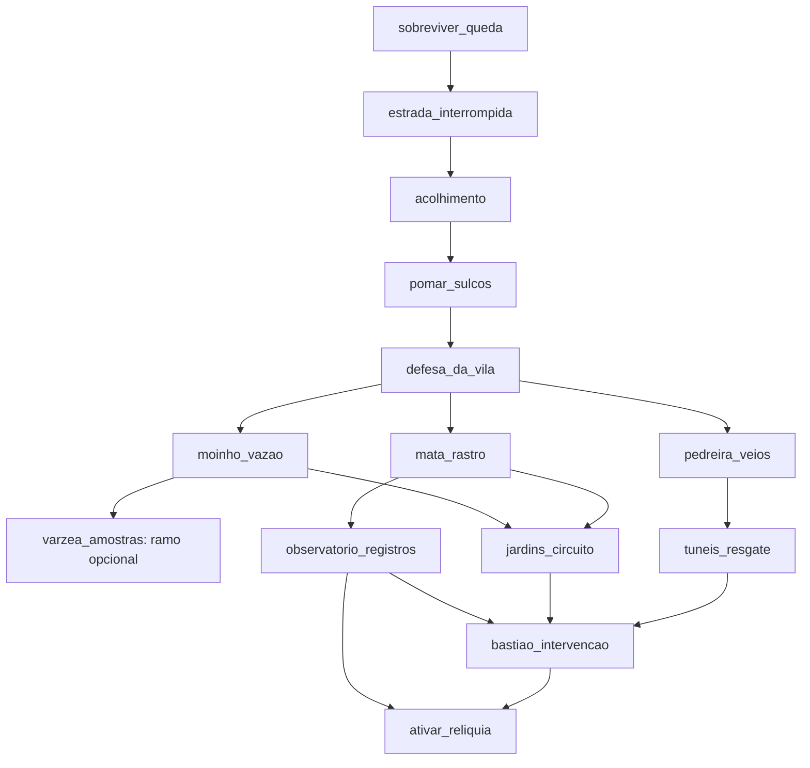

# Primeiro andar — Fichas de produção dos territórios

Fichas de produção atualizadas em 31/10/2026. As quatro áreas iniciais têm integração experimental; a chegada e a estrada possuem conteúdo modular e encontros próprios; a primeira defesa da vila também está integrada. Cada ficha distingue o trecho integrado das extensões planejadas. Os demais territórios continuam especificações futuras. O [roteiro vigente](PRIMEIRO_ANDAR.md) detalha o estado real. As [regras do protótipo](REGRAS_PRIMEIRO_ANDAR.md) definem progresso pessoal, sessões compartilhadas, relíquia fixa e preservação dos saves.

As conexões representam destinos/transições pelo mapa regional e passagens físicas dentro de cada área quando houver cena apropriada. Não significam carregar os doze territórios num único mapa. Uma região contém vários trechos exploráveis; o planejamento de encontros vai dimensionar sua extensão. A direção confirmada pelo usuário exige regiões grandes, com vários grupos de inimigos, missões ligadas à história, exploração opcional e consequências persistentes. O encontro único da cena de teste não define o conteúdo nem a duração de uma fase final.

## 1. Clareiras da Chegada — `chegada`

- **Função e preparo:** chegada e sobrevivência inicial; um a quatro jogadores, prólogo individual preservado para cada perfil.
- **Conexões:** geografia orientada para estrada e vila; na integração atual, concluir a clareira retorna ao mapa regional com indicação da Vila das Flores. Alcova de ruína dentro da área.
- **Missão integrada `sobreviver_queda`:** primeira chegada com invocação pulável; reentradas curtas e chegada breve para convidados durante uma vigília. Abrir o baú animado, recolher espada e escudo, enfrentar o rebento inicial, investigar sulcos e posto de resgate, vencer as três ondas e o Cerne Partido e descobrir a saída. Rebentos opcionais não precisam ser todos eliminados. Durante a cena de invocação, outros jogadores recebem um brilho e poeira no avatar que chega.
- **Descoberta:** marca do conjunto de emergência coincide com os marcos usados por resgatadores. O personagem ainda não sabe a explicação do chamado.
- **Inimigos:** rebentos perseguidores, com entrada gradual e espaço para aprender defesa. Outros inimigos só nos cantos opcionais.
- **Recompensa e persistência:** equipamento inicial e fato `saida_da_queda_descoberta`. Se os itens já tiverem sido recebidos, orientar seu uso sem gerar cópias na retomada.
- **Arte integrada:** terreno modular, equipamentos entregues pelo baú, ponte, ruínas, posto de resgate e cobertura florestal sazonal. Colisões nas bases, oclusão das copas e água com contrato de animação por quadros. A raiz gigante com seiva não é decoração. Nenhuma cratera cinematográfica gigante para a chegada do jogador.

## 2. Estrada dos Carreteiros — `estrada`

- **Função e preparo:** encontrar civilização e investigar perigo inicial; um a quatro.
- **Conexões:** acesso pelo mapa regional e retorno à vila integrados. Ligações físicas com Pomar/Bacia e atalho desbloqueável continuam planejados.
- **Missão `estrada_interrompida`:** disponível após `sobreviver_queda`; seguir vestígios até Dara no acesso à vila, receber um pedido de busca, examinar o carreto e localizar o trabalhador refugiado. Confirmar seu retorno na vila.
- **Descoberta:** as criaturas seguiram sulcos sob a estrada; carga e pegadas contam partes diferentes do evento.
- **Inimigos integrados:** nove rebentos em quatro encontros locais, usando combo e conjuração de raízes. Há espaço para contornar ataques e localizar o trabalhador sem eliminar todos. Uma espécie própria de lançador permanece planejada.
- **Opcional `memoria_do_carreteiro`:** localizar diário e retrato em duas paradas fora da rota direta e devolvê-los ao trabalhador; recompensa de história e fornecimento comum a calibrar.
- **Persistência integrada:** investigação do carreto, conversa com o trabalhador e relato a Dara pelo diário de campanha. O trabalhador permanece no abrigo; deslocamento até a vila, marco adicional `rota_resgatada` e retomada das entregas ainda são consequências planejadas.
- **Arte integrada:** mapa modular de 2048×1280, calçamento descontínuo, sulcos de rodas e trilha de fuga, carga caída, carroça danificada e abrigo, ambos com quatro estações. Trabalhador do gerador atual, camisa de trabalho, calça cargo, botinas e cabelo cacheado; sem sprite antigo de mercador.

## 3. Vila das Flores e Cinturão Rural — `vila`

- **Função e preparo:** cidade social, ofícios, fazenda e retorno; serviços acessíveis sem exigir grupo.
- **Conexões:** Estrada, Pomar, Bacia e Mata, apresentadas conforme descoberta. O mapa regional informa requisitos de cada destino.
- **Missão `acolhimento`:** após `estrada_interrompida`, falar com Lia, conhecer o indício da invocação com Estela e testar uma ação útil de ofício com um morador. Receber abrigo e o mapa regional; não exigir uma volta por todos os serviços.
- **Missão integrada `defesa_da_vila`:** após `pomar_sulcos`, montar a ligação de Ivo na entrada sul e resistir a três levas de rebentos. A ligação de ferro reduz a primeira leva; a de raiz reduz a vida dos inimigos. Depois da vitória, falar com Osvaldo sobre os reparos. Não há invasões repetidas automáticas.
- **NPCs:** Dara recebe viajantes; Lia coordena; Ivo fabrica; Rosa cuida; Tomás abastece; Nilo conhece rios; Osvaldo repara; Estela investiga.
- **Inimigos:** nenhum combate aleatório na cidade social. A defesa usa rebentos com papéis de aproximação, distância e proteção.
- **Opcional `mesa_dos_retornos`:** reunir produtos comuns por receitas alternativas e participar de uma refeição com pequenas histórias. Não depender de estação específica nem conceder pré-requisito escondido da campanha.
- **Recompensa e persistência:** `acolhido`, acesso aos ofícios pertinentes, `defesa_confirmada` e reputação narrativa de aliado. Fazenda e consequências são pessoais; presença dos outros jogadores é social.
- **Arte:** adaptar fachadas, interiores e serviços existentes; entrada identificável, praça, mercado e cinturão rural com quatro estações. Dara tem identidade própria usando a base compartilhada.

## 4. Pomar das Cercas Partidas — `pomar`

- **Função e preparo:** primeira investigação rural e ensaio de combate em grupo; preparo inicial.
- **Conexões:** Vila e Estrada; passagem lateral para Bacia após investigar os canais.
- **Missão `pomar_sulcos`:** após `acolhimento`, examinar três tipos de vestígio, recuperar uma parcela com Tomás e acompanhar por onde os rebentos contornam a barreira. Concluir ao registrar o fluxo de energia, não ao matar um total arbitrário.
- **Descoberta:** a cerca não resolve o ataque porque as criaturas seguem um circuito enterrado.
- **Inimigos:** perseguidor e defensor. A parcela ensina a contornar uma proteção; a área externa mantém perigos opcionais.
- **Opcional `semente_resistente`:** encontrar duas amostras em parcelas distintas e comparar o plantio; libera uma variedade local. Crescimento de campanha usa etapa controlada para evitar espera sazonal obrigatória.
- **Recompensa e persistência:** parcela recuperada, fato `sulcos_identificados`, disponibilidade da preparação da defesa.
- **Arte:** árvores frutíferas, cercas com trechos danificados/restaurados, sulcos e brotos. Restaurar uma parcela delimitada, sem sistema livre de reconstrução de toda a região.

## 5. Bacia do Moinho — `moinho`

- **Função e preparo:** água, fabricação e primeiro modelo de mecanismo; preparo estabelecido.
- **Conexões:** Vila, Estrada, Pomar e Várzeas. Passarela de manutenção encurta o retorno após reparo.
- **Missão `moinho_vazao`:** após `defesa_da_vila`, comparar três pontos de fluxo com Nilo, encontrar o caderno de Osvaldo e testar a posição das comportas. Reparar uma peça com os materiais indicados, ajustar o fluxo e confirmar o funcionamento.
- **Descoberta:** o desvio da antiga seca alimentou a vila e deixou um ramo do circuito sem refrigeração.
- **Inimigos:** rebentos próximos aos canais; encontros ficam separados da área de demonstração do mecanismo.
- **Opcional `rio_de_volta`:** liberar um ponto de pesca e comparar duas capturas do registro de campo; recompensa de preparo/receita, sem peixe raro obrigatório para a campanha.
- **Recompensa e persistência:** fato `agua_desviada`, estado `moinho_reparado`, receita de ligação mecânica e travessia curta.
- **Arte:** moinho, comportas em poucos estados, água conectada e bancos de trabalho. Reaproveitar peças e materiais existentes; canais têm direção visual legível.

## 6. Várzeas Afundadas — `varzeas`

- **Função e preparo:** território lateral com exploração ambiental e história própria; preparo estabelecido.
- **Conexões:** Bacia; rota para Pedreira liberada ao mapear a margem. Sem travessia por barco obrigatória.
- **Missão `varzea_amostras`:** após `moinho_vazao`, seguir a corrente, comparar duas fontes com Rosa e recuperar o registro de uma antiga travessia. Resolver a pergunta sobre a exposição mineral.
- **Descoberta:** a alteração segue o canal vindo da pedreira; o problema tem um trajeto físico reconhecível.
- **Inimigos:** lançadores e pequenos escavadores em margens bem sinalizadas; vegetação e água não escondem avisos essenciais.
- **Opcional `herbario_das_margens`:** registrar três plantas em microambientes diferentes, com alternativas sazonais equivalentes; recompensa de receita e contexto de Rosa.
- **Recompensa e persistência:** preparo protetor opcional que facilita exploração mineral, fato `origem_da_exposicao`, descoberta da passagem das margens. Esta missão não é exigida para abrir o chefe principal.
- **Arte:** baixios, juncos, plantas, ruína de travessia e dois estados controlados de água. Sem ciclos aleatórios longos para acessar missão.

## 7. Pedreira dos Veios Vivos — `pedreira`

- **Função e preparo:** domínio do combate e fabricação confiável; preparo investigativo.
- **Conexões:** entrada pelo mapa após descoberta com Ivo; passagens para Túneis, Várzeas e aproximação externa do Bastião. Encontrar a entrada do Bastião não libera sua intervenção.
- **Missão `pedreira_veios`:** após `defesa_da_vila`, seguir marcas de extração, comparar material de dois veios e testar com Ivo uma peça. Descobrir onde a mineração tocou o circuito antigo.
- **Descoberta:** os veios ativos e os materiais instáveis são parte da mesma ligação com o núcleo.
- **Inimigos:** escavador e guarda pesado; quebrador ocupa encontros opcionais com apoios preparados, sem terreno destrutível geral.
- **Opcional `forja_provada`:** vencer um encontro de guarda usando o equipamento fabricado ou uma alternativa de combate equivalente, demonstrando sua função; recompensa de projeto de especialização.
- **Recompensa e persistência:** fato `metal_do_circuito`, material classificado, projeto testado e ponto de apoio liberado.
- **Arte:** rocha, veios inativos/ativos, pátios e acampamento. Adaptar bases de caverna e mineração; novos veios precisam distinguir função além da cor.

## 8. Túneis do Carvão — `tuneis`

- **Função e preparo:** dungeon secundária e ensaio de checkpoints; um a quatro, preparo investigativo.
- **Conexões:** entrada pela Pedreira; saída de manutenção descoberta para um ponto de retorno seguro próximo da Bacia.
- **Missão `tuneis_resgate`:** após `pedreira_veios`, seguir os sinais da equipe isolada, restaurar apoios definidos e abrir uma câmara de manutenção. Encontrar uma dupla sobrevivente e recuperar o registro do técnico que saiu buscando outra rota; sua investigação mostra que retornou pela margem, e Rosa confirma o destino. Não deixar uma equipe desaparecer sem resolução narrativa.
- **Descoberta:** registro e tubulação mostram que o núcleo perdeu refrigeração. A equipe evitou ligá-lo novamente sem entender a causa.
- **Inimigos:** escavadores, guarda pesado e um encontro especial usando essa base com arena e padrão próprios.
- **Recompensa e persistência:** fato `nucleo_sem_refrigeracao`, sobreviventes de volta, saída de manutenção e recompensa de fabricação. Resgate e encontro têm checkpoints explícitos.
- **Arte:** módulos de túnel, apoios inteiros/danificados, câmara e sinais. A dupla usa variações da base NPC; sem novas animações exclusivas de perseguição nesta etapa.

## 9. Mata das Cascas Ocas — `mata`

- **Função e preparo:** rastreamento, leitura de inimigos e exploração não linear; preparo estabelecido/investigativo.
- **Conexões:** Vila, Observatório e Jardins; trilhas alternativas voltam à entrada da mata.
- **Missão `mata_rastro`:** após `defesa_da_vila`, observar as formações de rebentos, seguir uma delas e registrar onde se alimentam. O grupo pode recuperar a pista sem esperar um horário do calendário: o ciclo local é curto e repetível.
- **Descoberta:** raízes próximas aos jardins seguem um padrão diferente do observado nos ataques.
- **Inimigos:** os três rebentos, com patrulhas e encontros separados dos pontos de observação.
- **Opcional `cascas_e_memorias`:** associar três inscrições de exploradores a três marcos naturais; recompensa de história, registro e descoberta de um abrigo.
- **Recompensa e persistência:** fato `padrao_dos_rebentos`, jardins localizados e rota para Observatório registrada.
- **Arte:** massa florestal reaproveitada, três clareiras distintas, sinais, raízes e pequenos locais de abrigo. O jogador deve conseguir ler a rota na escala normal de câmera.

## 10. Observatório das Passagens — `observatorio`

- **Função e preparo:** compreender o mapa-múndi e usar a relíquia; preparo investigativo.
- **Conexões:** Mata e Vila pelo mapa regional após a primeira visita; atalho só quando seu acesso físico tiver sido aberto.
- **Missão `observatorio_registros`:** após `mata_rastro`, comparar a cartografia com Estela, reconhecer os encaixes e testar o mecanismo sem relíquia. Confirmar a existência de outros andares e registrar a necessidade de um vínculo de passagem.
- **Missão `ativar_reliquia`:** após `bastiao_intervencao` e `observatorio_registros`, usar o encaixe com confirmação, registrar `andar_02_revelado` e apresentar seu estado real de disponibilidade.
- **Descoberta:** o círculo do estudo visual é um instrumento de navegação por relíquias. Não é uma decoração ou um portal sem função narrativa.
- **Inimigos:** sentinela de conexão em pátio externo; o mecanismo não reinicia a luta durante a entrega.
- **Recompensa e persistência:** fato `mapa_de_passagens_compreendido` e uso idempotente da relíquia. Ativar não remove a conquista nem consome um item negociável.
- **Arte:** círculo com encaixes, inscrições e estados inativo/interpretado/ativado. Exigir legibilidade dos símbolos sem depender de texto minúsculo no chão.

## 11. Jardins da Raiz Antiga — `jardins`

- **Função e preparo:** aprender os princípios do puzzle e encerrar a investigação técnica; preparo investigativo/final.
- **Conexões:** Mata e aproximação do Bastião; via de retorno após reparar um trecho de manutenção.
- **Missão `jardins_circuito`:** após `mata_rastro` e `moinho_vazao`, observar um circuito preservado, testar uma seção pequena e devolver energia/água à saída correta. Comparar o resultado com a falha encontrada pelo grupo.
- **Descoberta:** captar, distribuir e devolver são relações do mecanismo; a refrigeração depende do retorno. O diário registra o princípio, não uma senha universal para copiar no chefe.
- **Inimigos:** sentinelas de canal e de conexão; avisos antecipam quais ligações estão ativas.
- **Opcional `jardim_reaceso`:** restaurar um canteiro de manutenção separado do circuito principal; recompensa de abrigo e história dos mantenedores.
- **Recompensa e persistência:** fato `principio_do_retorno`, seção restaurada e ponto seguro de expedição.
- **Arte:** canais compartilhados com moinho, raízes e mecanismos modulares. Mostrar direção, entrada e saída por formas e movimento, além de cores.

## 12. Bastião do Enxerto — `bastiao`

- **Função e preparo:** dungeon principal cooperativa; dois a quatro, preparo final.
- **Conexões:** aproximação pelos Jardins ou pela Pedreira; entrada interna exige elegibilidade. Saída retorna à região/cidade de origem; manutenção aberta vira atalho.
- **Missão `bastiao_intervencao`:** exige `tuneis_resgate`, `jardins_circuito` e `observatorio_registros`. A defesa e os ramos anteriores já são dependências dessas missões. Preparar a intervenção, resolver o circuito completo com duas funções complementares e enfrentar o Custódio.
- **Descoberta:** o mecanismo de proteção está extraindo energia da raiz para sustentar um circuito incapaz de resfriar. A intervenção usa o que foi investigado, sem revelar outro culpado aleatório na última sala.
- **Inimigos:** sentinelas e cascudos; rebentos em encontros coerentes com a alimentação pelas raízes. O chefe tem fases de circuito e combate especificadas antes da produção final.
- **Recompensa e persistência:** `custodio_vencido`, intervenção confirmada, reputação de defensor e `reliquia_primeira_raiz`. Uma conclusão elegível por personagem/campanha, com recompensa pendente recuperável.
- **Consequência:** a vila reconhece a solução local, o complexo mantém estado pós-vitória e a repetição vira expedição compatível com esse estado. A próxima tarefa é `ativar_reliquia` no Observatório.
- **Arte:** pátios, salas e raiz/núcleo compartilham módulos dos jardins, mina e ruínas; silhueta de chefe própria, portas e pontos seguros legíveis. Interior é um projeto separado do ícone do mapa.

## Dependências da campanha

As oito atividades opcionais são: memória do carreteiro, mesa dos retornos, semente resistente, rio de volta, herbário das margens, forja provada, cascas e memórias e jardim reaceso. A missão local das várzeas também pode ser concluída por sua história e recompensa sem se tornar uma trava da relíquia.

## Ordem de montagem do primeiro percurso

1. Clareira com equipamento, saída e estado de retomada.
2. Estrada com rastros, encontro de Dara e resolução do resgate.
3. Vila com Lia/Estela, mapa regional e um serviço útil.
4. Pomar com investigação, encontro e consequência local.
5. Retorno à vila com diário atualizado e preparo da defesa disponível.

Esse percurso valida a relação entre narrativa, região e estado salvo. É uma parte do andar; não substitui os demais territórios nem certifica o multiplayer sem os testes correspondentes.
